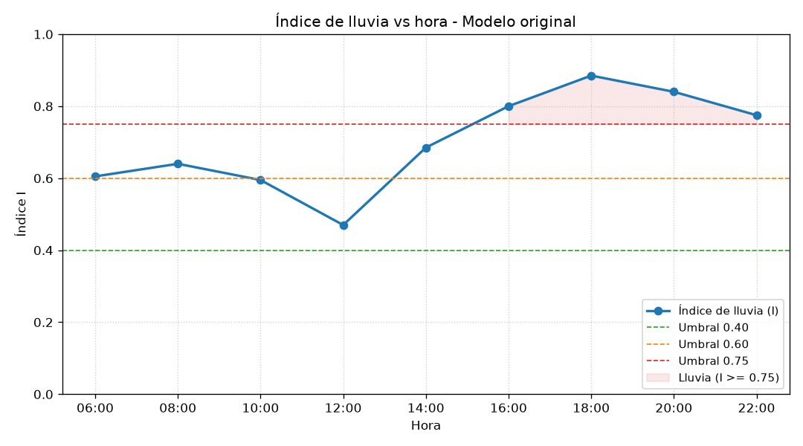
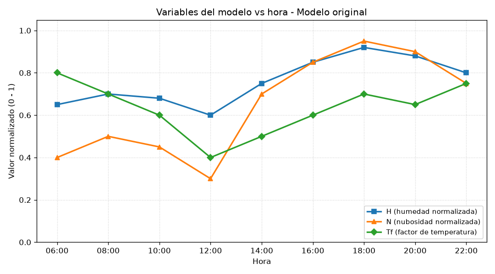
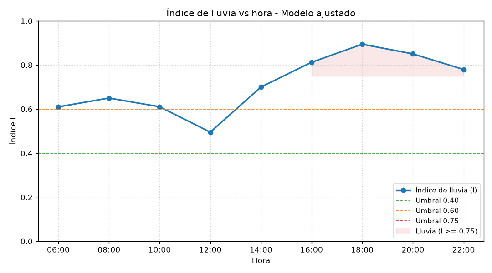

## 1. Descripción del proyecto

Este proyecto simula un índice de posibilidad de lluvia a partir de la humedad,
la nubosidad y la temperatura observadas durante un día. Su propósito es aplicar
un modelo matemático sencillo, interpretar sus resultados y estudiar cómo cambian
al modificar sus parámetros.

Utiliza los mismos nueve registros para comparar dos versiones del modelo:
**original**, con pesos `0.5`, `0.3` y `0.2`, y **ajustada**, con pesos `0.6`,
`0.25` y `0.15`. Calcula las variables normalizadas, el índice y el estado de
lluvia para cada hora; luego presenta tablas y gráficas.

No se usa aleatoriedad: las mismas entradas y los mismos pesos producen los
mismos resultados. El índice es una clasificación didáctica, no una probabilidad
meteorológica validada.

## 2. Tecnologías utilizadas

- **Python 3.x:** lenguaje de programación.
- **Matplotlib 3.11.2:** genera y muestra las gráficas.
- **NumPy 2.5.3:** dependencia incluida en la práctica; el código actual no la utiliza directamente.

El programa se organiza en modelo, vista y controlador (MVC). No usa NetLogo ni
pyNetLogo. Esta carpeta contiene la implementación en Python; la guía original
solicita también una implementación en Java.

## 3. Instalación

En Linux, descarga el proyecto y descomprímelo. Abre una terminal en la carpeta
que contiene `practica01-simulacion` y ejecuta, en este orden:

```bash
cd practica01-simulacion/python
python3 -m venv venv
source venv/bin/activate
pip install -r requirements.txt
```

Si ya tienes el proyecto descargado, comienza entrando a su carpeta `python/`.
El entorno virtual mantiene las dependencias separadas de otros proyectos.

No hay un archivo `config.py`. Los datos y los pesos están en
`python/controlador/clima_controlador.py`:

```python
# Cada registro contiene: hora, humedad (%), nubosidad (%) y temperatura (°C).
DATOS = [
    ("06:00", 65, 40, 14),
    ("08:00", 70, 50, 16),
    ("10:00", 68, 45, 18),
    ("12:00", 60, 30, 22),
    ("14:00", 75, 70, 20),
    ("16:00", 85, 85, 18),
    ("18:00", 92, 95, 16),
    ("20:00", 88, 90, 17),
    ("22:00", 80, 75, 15),
]

PESOS_ORIGINAL = (0.5, 0.3, 0.2)
PESOS_AJUSTADO = (0.6, 0.25, 0.15)
```

Los pesos corresponden, en orden, a humedad, nubosidad y factor de temperatura.
En ambas versiones suman `1`. Las reglas de clasificación y la fórmula del factor
de temperatura están en `python/modelo/clima_modelo.py`.

## 4. Uso

Con el entorno activado, desde `practica01-simulacion/python/`:

```bash
python main.py
```

El programa imprime la tabla del modelo original y abre sus dos gráficas.
**Cierra esas ventanas para continuar con el modelo ajustado**, que imprime otra
tabla y abre otras dos gráficas. También guarda las cuatro imágenes en
`python/resultados/`.

Cada tabla contiene hora, humedad, nubosidad, temperatura, `H`, `N`, `Tf`, índice
y estado. El modelo y la vista no tienen comandos independientes: el flujo
completo se ejecuta desde `main.py`.

Ejemplo del inicio de la salida:

```text
PRÁCTICA 01 - SIMULACIÓN: modelo matemático de lluvia
I = peso_h*H + peso_n*N + peso_tf*Tf

================================================================================
MODELO ORIGINAL - pesos 0.50 / 0.30 / 0.20
================================================================================
```

Ejemplo de valores de la primera fila, resumidos:

```text
Hora: 06:00 | H: 0.650 | N: 0.400 | Tf: 0.800
Índice original: 0.605 | Estado: Lluvia probable
```

Para ejecutar sin abrir ventanas, por ejemplo desde una terminal sin escritorio:

```bash
MPLBACKEND=Agg python main.py
```

En ese caso se imprimen las tablas y se guardan las imágenes; el mensaje del
programa sobre las ventanas puede aparecer aunque no se abran.

Para salir del entorno virtual al terminar:

```bash
deactivate
```

## 5. Estructura del proyecto

```text
practica01-simulacion/
├── README.md
├── APE 1 Chamba_Richard.pdf
├── .gitignore
└── python/
    ├── APEGUIA.pdf
    ├── main.py
    ├── requirements.txt
    ├── modelo/
    │   ├── __init__.py
    │   └── clima_modelo.py
    ├── controlador/
    │   ├── __init__.py
    │   └── clima_controlador.py
    ├── vista/
    │   ├── __init__.py
    │   └── clima_vista.py
    └── resultados/                 # Se crea al ejecutar.
        ├── indice_original.png
        ├── componentes_original.png
        ├── indice_ajustado.png
        └── componentes_ajustado.png
```

- `README.md`: explica la instalación, el funcionamiento y los resultados.
- `APE 1 Chamba_Richard.pdf`: documento de la práctica incluido en el proyecto.
- `.gitignore`: indica qué archivos locales se excluyen del repositorio.
- `python/`: contiene la implementación en Python.
- `APEGUIA.pdf`: guía original con los datos, la fórmula y las reglas.
- `main.py`: crea el controlador e inicia la simulación.
- `requirements.txt`: lista las dependencias con sus versiones.
- `modelo/`: contiene los cálculos matemáticos.
- `clima_modelo.py`: normaliza las variables, calcula el índice y determina el estado.
- `controlador/`: coordina la ejecución de las dos versiones del modelo.
- `clima_controlador.py`: define datos y pesos, llama al modelo y entrega los resultados a la vista.
- `vista/`: contiene la presentación de los resultados.
- `clima_vista.py`: imprime las tablas y guarda y muestra las gráficas.
- Los tres archivos `__init__.py`: identifican los paquetes de Python.
- `resultados/`: contiene las cuatro imágenes generadas.
- `indice_original.png` e `indice_ajustado.png`: muestran el índice y sus umbrales.
- `componentes_original.png` y `componentes_ajustado.png`: muestran `H`, `N` y `Tf`.

El flujo es `main.py → controlador → modelo → vista`. No hay archivos
`config.py` ni `parametros.py`: los datos y parámetros se definen en el controlador.

## 6. Información adicional

**Fundamento teórico**

La humedad y la nubosidad se normalizan dividiendo sus porcentajes entre `100`.
El factor de temperatura disminuye linealmente con la temperatura, limitado al
rango de `0.1` a `1.0`:

```python
H = humedad / 100
N = nubosidad / 100
Tf = max(0.1, min(1.0, 1.0 - 0.05 * (temperatura - 10)))
I = peso_h * H + peso_n * N + peso_tf * Tf
```

`H` es la humedad normalizada, `N` la nubosidad normalizada, `Tf` el factor de
temperatura e `I` el índice de lluvia. Los pesos indican la contribución de cada
variable al índice.

La fórmula de `Tf` reproduce los valores de la tabla de la guía y usa una
interpolación lineal para las temperaturas intermedias: `15 °C → 0.75` y
`17 °C → 0.65`.

| Índice | Estado |
|---|---|
| I < 0.40 | Sin lluvia |
| 0.40 ≤ I < 0.60 | Baja posibilidad |
| 0.60 ≤ I < 0.75 | Lluvia probable |
| I ≥ 0.75 | Lluvia |

**Estimación de parámetros**

En esta práctica no se estiman parámetros estadísticamente. Los pesos originales
proceden de la guía y los ajustados son un escenario de comparación:

| Versión | Humedad | Nubosidad | Temperatura |
|---|---:|---:|---:|
| Original | 0.50 | 0.30 | 0.20 |
| Ajustada | 0.60 | 0.25 | 0.15 |

El ajuste aumenta la importancia de la humedad y reduce las otras dos. No se
utilizan `r`, `σ` ni `dt`, porque este modelo calcula un índice por observación,
no una evolución poblacional.

**Resultados**

Las imágenes aparecen después de ejecutar el programa:



El índice original alcanza su mínimo a las `12:00` (`0.470`) y su máximo a las
`18:00` (`0.885`). El estado es «Lluvia» desde las `16:00` en los registros dados.
Las líneas horizontales muestran los límites de clasificación.



La gráfica permite relacionar el índice con sus entradas. A las `12:00`, la menor
nubosidad y el menor factor de temperatura contribuyen a reducirlo. A las
`18:00`, la humedad y la nubosidad altas favorecen un índice mayor.



El índice ajustado es mayor en los nueve registros. A las `10:00` pasa de `0.595`
a `0.611`, por lo que cambia de «Baja posibilidad» a «Lluvia probable». El mínimo
ajustado es `0.495` y el máximo `0.8945`.


Las componentes son iguales a las del modelo original: se conservan los datos y
la normalización. Solo cambian los pesos que las combinan para calcular el índice.

El modelo es una suma ponderada: aumentar una variable aumenta el índice si su
peso es positivo. Con los pesos originales, un punto porcentual adicional de
humedad aumenta `I` en `0.005`; uno de nubosidad lo aumenta en `0.003`. Entre
`10 °C` y `28 °C`, un grado adicional reduce `I` en `0.01`.

**Preguntas de control**

Las cinco preguntas siguientes corresponden a la sección 7 de la guía de esta
práctica. Algunas se refieren al modelo exponencial, aunque el ejercicio
implementado estudia la lluvia.

1. **¿Qué es un modelo matemático?** Una representación simplificada de un sistema mediante variables, parámetros y relaciones matemáticas.
2. **¿Cuál es la diferencia entre variable y parámetro?** Una variable representa una magnitud que puede cambiar, como la humedad; un parámetro define el modelo, como el peso asignado a esa humedad.
3. **¿Qué representa P₀?** La población inicial en un modelo poblacional. No interviene en este modelo de lluvia.
4. **¿Qué ocurre cuando r < 0?** En el modelo exponencial poblacional, la población decrece. Este modelo de lluvia no utiliza `r`.
5. **¿Qué limitaciones tiene el modelo exponencial?** Supone una tasa constante y no incorpora límites de recursos ni capacidad de carga. Por su parte, el modelo de lluvia omite factores como presión, viento y evolución previa del clima.

**Autor, asignatura y fecha**

Richard Ariel Chamba Santin. Simulación, Universidad Nacional de Loja (UNL),
Carrera de Computación, ciclo 5. Fechas de la práctica: 1 y 2 de octubre de 2026.
