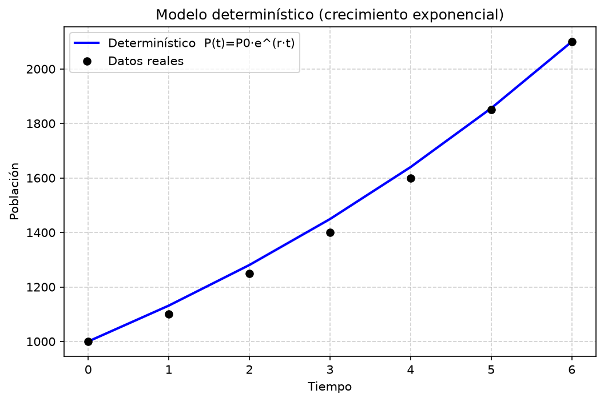
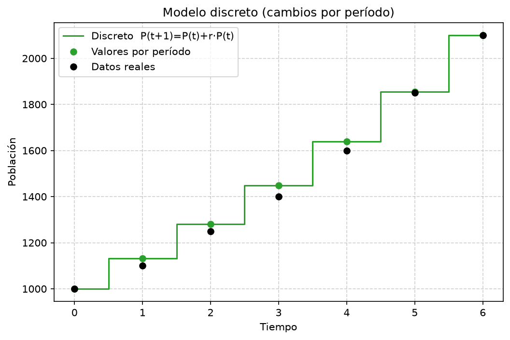
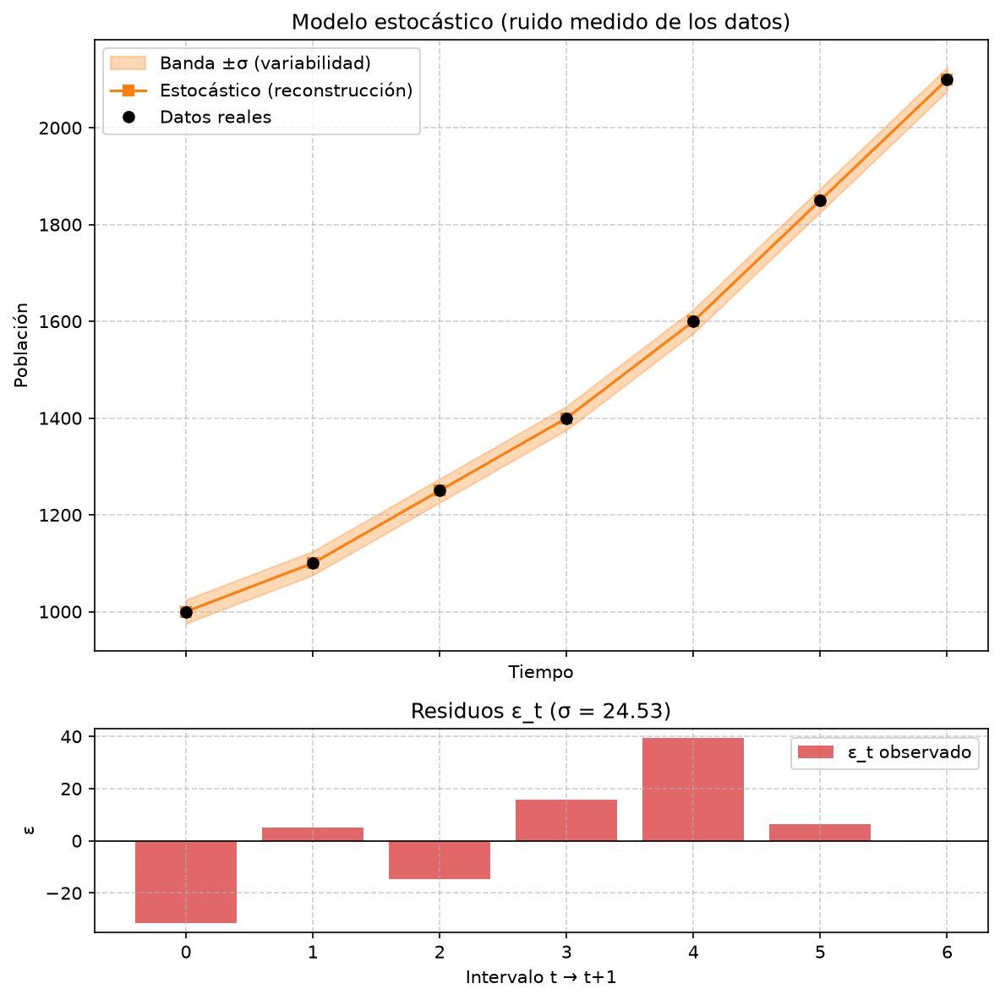
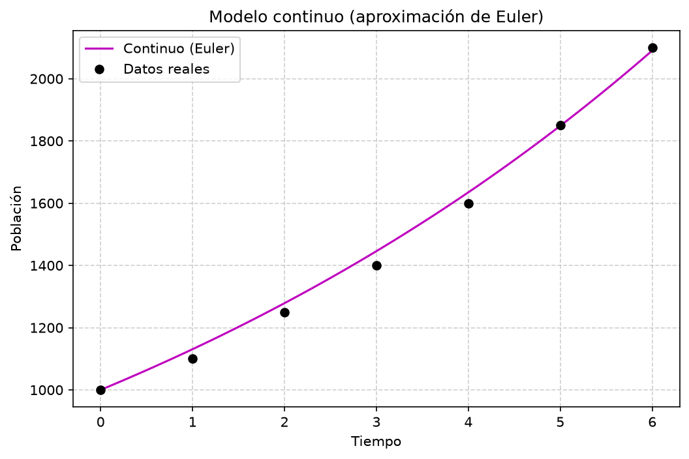
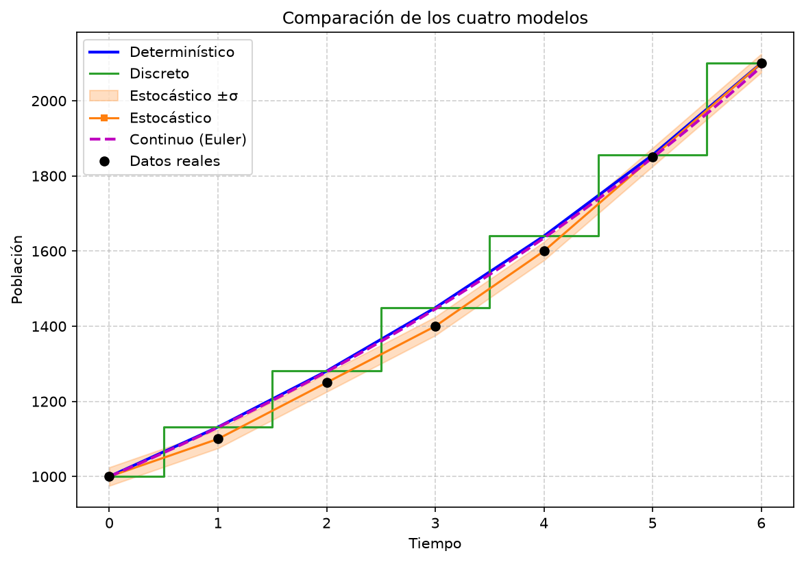
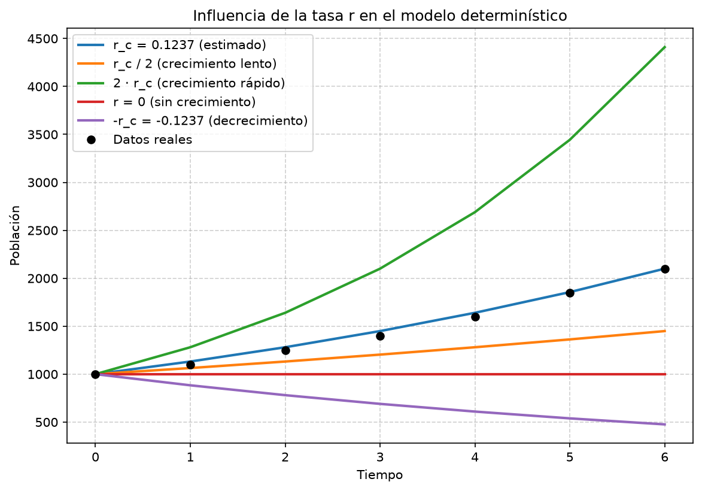

## 1. Descripción del proyecto

Compara cuatro modelos de simulación del crecimiento poblacional: determinístico,
discreto, estocástico y continuo. Todos usan los mismos datos para estudiar cómo
cambia la población y cómo influye la tasa de crecimiento.

No se usa aleatoriedad: la variabilidad (σ) se mide a partir de los residuos de los
datos. El modelo estocástico es una adaptación del algoritmo del APE: utiliza esos
residuos en lugar de generar ruido aleatorio. Reconstruye las observaciones; no es
una predicción independiente.

## 2. Tecnologías utilizadas

- **Python 3.x:** lenguaje de programación.
- **NumPy:** arreglos, tasas y desviación estándar.
- **Pandas:** tabla comparativa.
- **Matplotlib:** gráficas.
- **SciPy:** dependencia indicada en la práctica; no se necesita en estos algoritmos.

No se usa NetLogo ni pyNetLogo.

## 3. Instalación

En Linux, descarga el proyecto y descomprímelo. Abre una terminal en la carpeta
que contiene `practica02-simulacion` y ejecuta, en este orden:

```bash
cd practica02-simulacion
python -m venv venv
source venv/bin/activate
pip install -r requirements.txt
```

La descarga evita necesitar una dirección de repositorio. Si obtienes el proyecto
mediante Git, entra igualmente a `practica02-simulacion` antes de crear el entorno.

En `config.py` puedes cambiar los datos, el paso de Euler y el tipo de desviación estándar:

```python
DATOS = np.array([1000, 1100, 1250, 1400, 1600, 1850, 2100], dtype=float)
DT = 0.1
DDOF = 1  # Desviación estándar muestral.
```

Usa al menos tres poblaciones positivas, observadas en períodos igualmente
espaciados. Para esta práctica, usa un `DT` positivo que divida cada período,
como `1`, `0.5` o `0.1`. Las tasas y los residuos se recalculan al cambiar los datos.

## 4. Uso

Con el entorno activado y desde la carpeta del proyecto:

```bash
python main.py
```

Muestra las tasas `r`, `σ` (como `sigma`), `dt`, los residuos y una tabla comparativa.
Guarda seis imágenes en `resultados/`; puedes abrirlas con tu visor de imágenes.

También puedes ejecutar los parámetros y cada modelo por separado:

```bash
python parametros.py
python -m modelos.deterministico
python -m modelos.discreto
python -m modelos.estocastico
python -m modelos.continuo
```

Estos comandos imprimen resultados numéricos. Las gráficas se generan juntas con
`python main.py`; sus archivos contienen funciones que llama el programa principal.

Ejemplo del inicio de la salida:

```text
r discreto = 0.131627
r continuo = 0.123656
sigma = 24.5314
dt = 0.1
Residuos medidos:
```

Al finalizar aparece una tabla por período y el mensaje:

```text
Se guardaron seis gráficas en resultados/.
```

## 5. Estructura del proyecto

```text
practica02-simulacion/
├── README.md
├── CONTEXT.md
├── ape_guia simulacion semana 2-firmado-signed.pdf
├── requirements.txt
├── .gitignore
├── config.py
├── parametros.py
├── main.py
├── modelos/
│   ├── __init__.py
│   ├── deterministico.py
│   ├── discreto.py
│   ├── estocastico.py
│   └── continuo.py
├── graficas/
│   ├── __init__.py
│   ├── _base.py
│   ├── grafica_deterministico.py
│   ├── grafica_discreto.py
│   ├── grafica_estocastico.py
│   ├── grafica_continuo.py
│   ├── grafica_comparativa.py
│   └── grafica_influencia_r.py
└── resultados/
    ├── deterministico.png
    ├── discreto.png
    ├── estocastico.png
    ├── continuo.png
    ├── comparativa.png
    └── influencia_r.png
```

- `README.md`: explica la instalación, el uso y los resultados.
- `CONTEXT.md`: contiene las instrucciones y restricciones del proyecto.
- El PDF del APE: contiene la guía original y los algoritmos de la práctica.
- `requirements.txt`: lista las dependencias.
- `.gitignore`: excluye el entorno virtual y los archivos temporales de Python.
- `config.py`: define los datos, `DT`, `DDOF` y los escenarios de crecimiento.
- `parametros.py`: calcula las tasas, los residuos y σ.
- `main.py`: ejecuta los modelos, genera las gráficas e imprime la comparación.
- `modelos/`: contiene los algoritmos, sin dibujar gráficas.
- `modelos/__init__.py`: identifica el paquete de modelos.
- `deterministico.py`: calcula la población con la fórmula exponencial.
- `discreto.py`: actualiza la población una vez por período.
- `estocastico.py`: actualiza la población incorporando los residuos medidos.
- `continuo.py`: aproxima el crecimiento con pasos de Euler.
- `graficas/`: contiene las funciones que dibujan los resultados.
- `graficas/__init__.py`: identifica el paquete de gráficas.
- `_base.py`: prepara los ejes y guarda las imágenes.
- `grafica_deterministico.py`: dibuja el modelo exponencial.
- `grafica_discreto.py`: dibuja los cambios por período.
- `grafica_estocastico.py`: dibuja la reconstrucción, la banda ±σ y los residuos.
- `grafica_continuo.py`: dibuja la aproximación de Euler con un solo `DT`.
- `grafica_comparativa.py`: reúne los cuatro modelos.
- `grafica_influencia_r.py`: compara tasas positivas, nula y negativa.
- `resultados/`: guarda las seis imágenes generadas, una por cada gráfica.

## 6. Información adicional

**Fundamento teórico**

Los cálculos siguen los algoritmos del APE: definir parámetros, calcular la
población, guardar cada resultado y retornar tiempo y población. En el modelo
estocástico se sustituye el ruido aleatorio por residuos medidos, según la
restricción de este proyecto.

| Modelo | Fórmula |
|---|---|
| Determinístico | P(t) = P0 · exp(r_c · t) |
| Discreto | P(t+1) = P(t) + r_d · P(t) |
| Estocástico adaptado | P(t+1) = max(0, P(t) + r_d · P(t) + ε_t) |
| Continuo, Euler | P(t+dt) = P(t) + dt · r_c · P(t) |

`P0` es la población inicial. `r` es la tasa de crecimiento (`r_d` por período y
`r_c` continua). `σ` mide la dispersión de los residuos. `dt` es el tamaño del
paso de Euler. Los modelos por pasos toman la última población calculada para
obtener la siguiente.

**Estimación de parámetros**

Con `n = len(datos) - 1`, se calculan:

```python
r_d = (datos[-1] / datos[0]) ** (1 / n) - 1
r_c = np.log(datos[-1] / datos[0]) / n
epsilon = datos[1:] - (datos[:-1] + r_d * datos[:-1])
sigma = np.std(epsilon, ddof=1)
```

Se cumple `1 + r_d = exp(r_c)`. Por eso el modelo determinístico y el discreto
coinciden en los tiempos enteros. `sigma` es la desviación estándar muestral,
no un intervalo de confianza.

**Resultados**



La fórmula exponencial describe crecimiento con tasa continua constante positiva.



La población se actualiza por períodos multiplicando por `1 + r_d`.



Los residuos medidos reconstruyen los datos, salvo redondeo numérico. La banda
±σ ilustra su dispersión; no representa incertidumbre predictiva estimada.



Euler aproxima la ecuación `dP/dt = r_c · P`. Con tasa positiva queda por debajo
del exponencial exacto; reducir `dt` mejora la aproximación.



Los cuatro enfoques usan la misma población inicial. Determinístico y discreto
coinciden en los períodos; Euler tiene error de aproximación y la reconstrucción
con residuos reproduce las observaciones.



Una tasa positiva mayor acelera el crecimiento; `r = 0` mantiene la población
constante y una tasa negativa produce decrecimiento exponencial.
